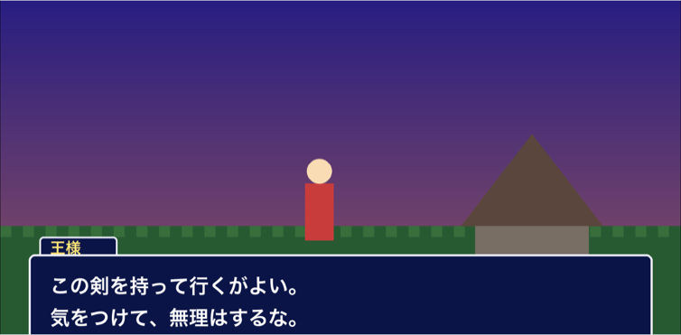
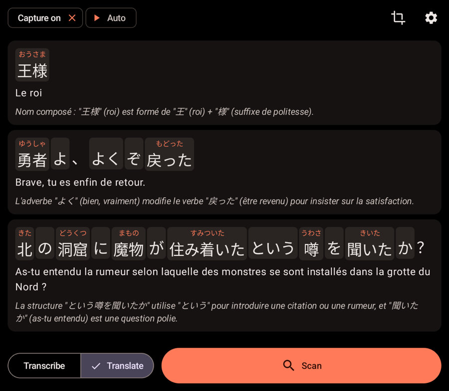
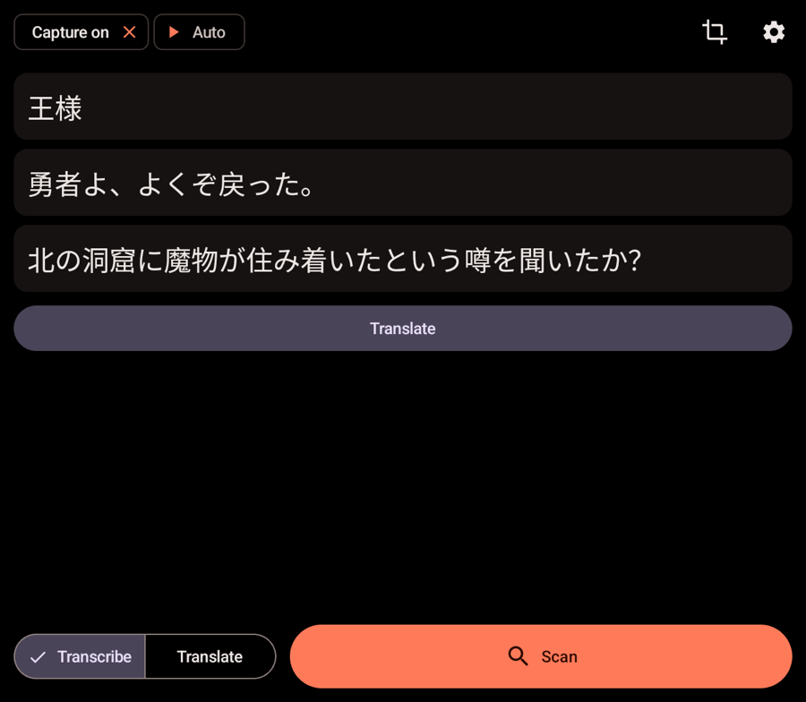
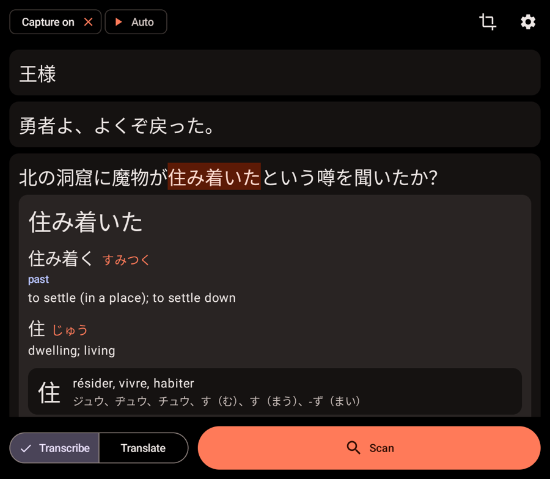
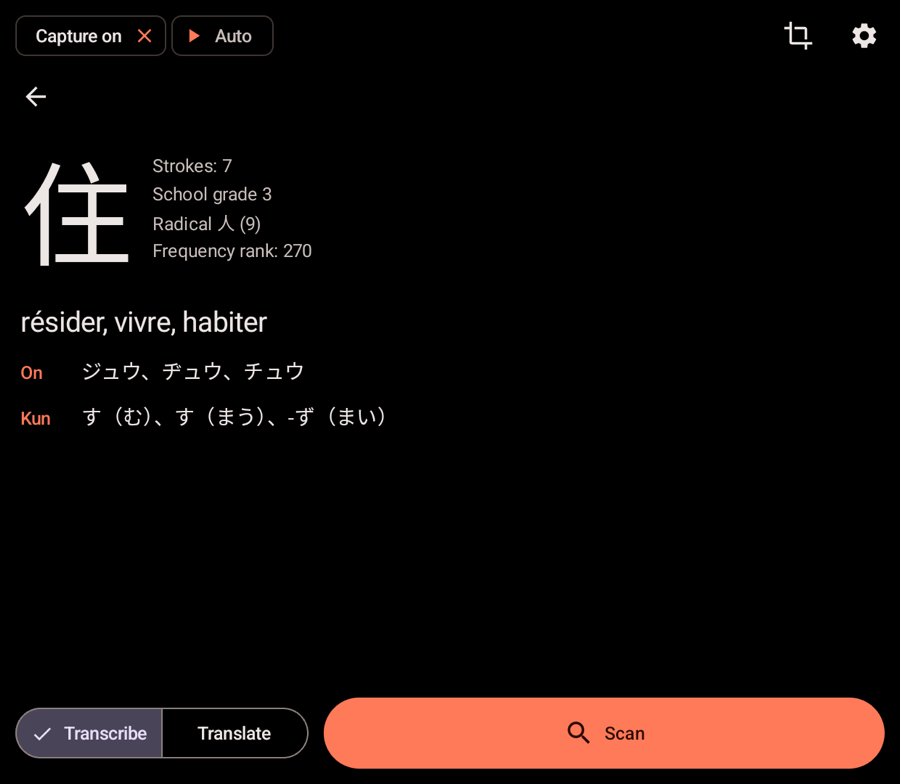
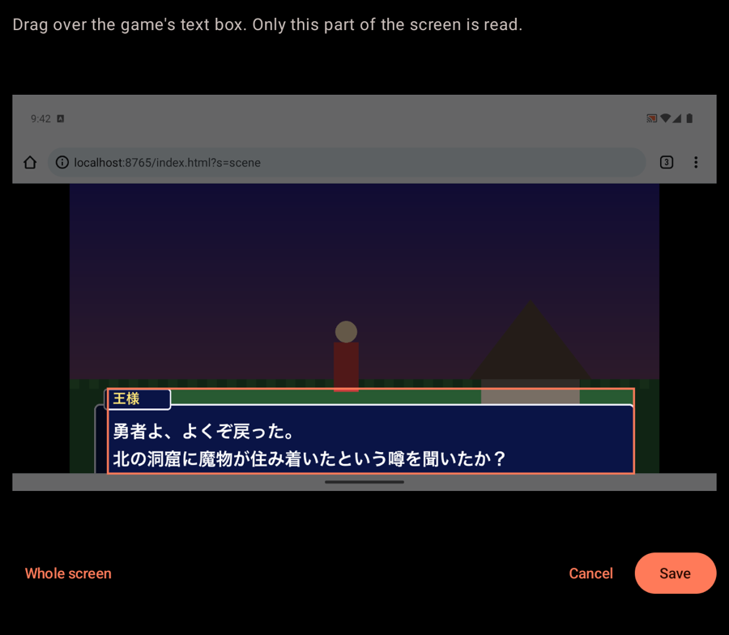

# AYN Rikai

Play Japanese games on the top screen of a dual-screen Android handheld and read them on the
bottom screen. Touch any character and the whole word or grammar pattern it belongs to lights
up, with its reading and meaning, like the rikaikun browser extension. The dictionary works
offline. When you want more, each line gets a translation, furigana and a grammar note.

Built for the [AYN Thor](https://www.ayntec.com/), and works on other Android 11+ devices with a
second screen. Bring your own model: Mistral (default), or any OpenAI-compatible server
such as OpenAI, OpenRouter, Ollama or LM Studio. It also has an offline mode with on-device OCR.

| Top screen: the game | Bottom screen: the lines |
| --- | --- |
|  |  |

| Transcribe, then translate on demand | Tap a word |
| --- | --- |
|  |  |

| Tap a kanji | Read only the text box |
| --- | --- |
|  |  |

## Features

- **Reads the game screen.** Android screen capture grabs the top screen when you press
  **Scan**, and the Japanese text appears on the bottom screen.
- **Two modes**, switched at the bottom of the screen:
  - **Transcribe** shows only the Japanese text, which is faster and cheaper. Tap
    **Translate** under a scan when you need its translation.
  - **Translate** reads, translates and explains every line in one go.
- **Tap any character.** The whole group it belongs to is highlighted: a word with all its
  endings, a compound or a set expression. You get its reading, romaji, meaning and dictionary
  entries, with the conjugations that lead back to the dictionary form, for example
  食べさせられなかった → 食べる: causative, passive, negative, past. Lookups come from JMdict
  and a deinflector on the device, so they are instant and work offline. Tap the same group
  again to close it.
- **Kanji pages.** Each kanji of the group opens strokes, school grade, radical, frequency,
  on and kun readings and meanings from KANJIDIC2, offline.
- **Auto mode.** Watches the screen (every 1 to 10 s, 2 s by default) and reads it only when
  the picture changes, so dialogue follows you without button presses and without paying for
  identical frames.
- **Text box region.** Drag a rectangle over the game's dialogue box so menus and HUD
  are ignored. The region is saved.
- **Keeps the controller on the game.** Touching the bottom screen does not steal the
  buttons from the emulator on the top screen. This can be turned off in the settings.
- **Furigana and romaji**, each optional.
- **Translates into** English, French, Spanish, German, Italian, Portuguese, Dutch, Polish,
  Russian, Ukrainian, Chinese, Korean, Arabic, Turkish, Indonesian or Vietnamese.
  Dictionary meanings are in English, from JMdict.
- English and French interface.

### How a tapped group is chosen

On lines translated by the model, the groups are the model's units of meaning: verbs with
their auxiliaries (行ってしまった), compounds (冒険者) and grammar patterns (かもしれない),
each with a gloss for this context. When the model cuts a conjugated verb from its ending
(戻っ / た), the dictionary joins the two back. On transcribed lines, the dictionary splits the line into
the fewest words it knows, so 冒険者は行ってしまった reads as 冒険者 / は / 行ってしまった.

## Install

Download `ayn-rikai-<version>.apk` from the
[latest release](https://github.com/alouafi/ayn-rikai/releases/latest) and open it on the
device, or:

- **Obtainium:** add `https://github.com/alouafi/ayn-rikai` as an app source to get updates.
- **adb:** `adb install ayn-rikai-<version>.apk`.

The APK is arm64 only (`arm64-v8a`), like the AYN Thor and most recent handhelds.

Version 0.1.0 was called AYN Translate (`io.github.alouafi.ayntranslate`). AYN Rikai is a new
app id, so uninstall AYN Translate and enter your API key again.

## Set up on the AYN Thor

1. Open **AYN Rikai** from the app drawer. From Cocoon or any other launcher on the top
   screen, it moves itself to the bottom screen.
2. Tap the gear, choose a model and paste your API key. For Mistral, create a key at
   [console.mistral.ai](https://console.mistral.ai/). Then tap **Test connection**.
3. Go back and tap **Start capture**. Android asks for permission **on the top screen**: choose
   **Start now**. A notification stays visible while the capture is on. Stop it with the ✕
   next to "Capture on".
4. Pick **Transcribe** or **Translate** next to the **Scan** button.
5. Start your game on the top screen and press **Scan**, or turn on **Auto**.
6. Optional: tap the crop icon and drag over the game's text box.

Android forgets the capture permission when the capture stops, so you confirm it once per
play session.

## How the screen is read

The **Read the text with** setting picks what reads the screenshot:

| Read the text with | Transcribe | Translate | Needs |
| --- | --- | --- | --- |
| **Vision model** (default) | The model copies the text from the screenshot. | One request reads, translates and splits the text into words. | A model that accepts images |
| **On-device OCR** | Offline: nothing leaves the device. | OCR reads the text, then the model translates it. | Nothing online to transcribe |
| **Mistral OCR** | Mistral OCR reads the text. | Mistral OCR reads the text, then the model translates it. | A Mistral API key |

The **Translate** button under a transcription sends the text, not the screenshot, to the
model.

OCR engines:

- **On device:** Google ML Kit's Japanese model, bundled in the APK. It is free and works
  offline, and is best on clean, large fonts. On small pixel fonts it can misread kanji.
- **Mistral OCR** (`mistral-ocr-latest`): better on small and pixel fonts. It uses your
  Mistral API key.

### Models

- **Mistral** (default provider): **Small** (`mistral-small-latest`) is the default and the
  recommended model. In tests on game dialogue, Medium sometimes "corrected" the game's text
  into a more common phrase (for example 来た instead of 戻った), while Small copied it
  faithfully.
- **OpenAI-compatible:** set the base URL, an optional API key and the model name. Examples:
  - OpenAI: `https://api.openai.com/v1` with `gpt-4.1-mini`
  - OpenRouter: `https://openrouter.ai/api/v1`
  - Ollama or LM Studio on your network: `http://192.168.1.20:11434/v1` with a vision model
    such as `qwen2.5vl`

  The vision model source needs a model that accepts images. The OCR sources work with
  text-only models.

Each scan that goes online sends one JPEG of the game screen, at most 1600 px on the long
side. With a region, it sends only the region.

## Privacy

- Screenshots go only to the provider you configure, and only when you scan or when Auto
  sees a new picture. With on-device OCR in Transcribe mode, nothing leaves the device.
- Tap lookups never leave the device.
- API keys are encrypted with a key held in the Android Keystore. App data is excluded from
  backups and device transfers.
- The app has no analytics and makes no other network calls. Google ML Kit, used for
  on-device OCR, may send anonymous usage metrics to Google, but your screenshots stay on
  the device.

## Build

Requirements: JDK 21 and the Android SDK (compile SDK 37).

```sh
./gradlew testDebugUnitTest lintDebug assembleRelease
```

The APK is written to `app/build/outputs/apk/release/`. To sign it with your own key, create
`keystore.properties` at the repository root (it is ignored by git):

```properties
storeFile=/absolute/path/to/release.jks
storePassword=...
keyAlias=...
keyPassword=...
```

You can also set the `AYN_RIKAI_STOREFILE`, `AYN_RIKAI_STOREPASSWORD`,
`AYN_RIKAI_KEYALIAS` and `AYN_RIKAI_KEYPASSWORD` environment variables. Without a
signing key, the release build is signed with the debug key.

### Project layout

```
app/src/main/kotlin/io/github/alouafi/aynrikai/
  analysis/    prompts, JSON parsing, the screen readers for each mode, joining split verbs
  capture/     MediaProjection service, frame capture, captured images, scene change detection
  dictionary/  offline word and kanji dictionaries, deinflector, kana and romaji helpers
  display/     finds the second screen and opens activities on a given screen
  llm/         OpenAI-compatible chat client (Mistral uses the same API)
  net/         JSON POST helper and API errors
  ocr/         ML Kit and Mistral OCR
  settings/    settings, encrypted keys, region
  ui/          launcher, companion (bottom screen), settings, capture consent
scripts/build_kanji_data.py   rebuilds app/src/main/assets/kanji.tsv from KANJIDIC2
scripts/build_word_data.py    rebuilds app/src/main/assets/words.tsv and word_index.tsv from JMdict
```

## Status

Version 0.2.0 was tested on an Android 13 emulator set up like the Thor: a 1920×1080 main
screen and a 1240×1080 second screen. The tests covered:

- Transcribe with every text source (vision model, on-device OCR, Mistral OCR), Translate
  with the vision model and Mistral OCR, the Translate button, tap lookups and kanji pages.
- Tested with 0.1.0 only: the OpenAI-compatible provider, Auto, the region editor and
  controller focus staying on the game.

It has not been tested on a real AYN Thor yet. Issues and pull requests are welcome.

## Credits and license

The code is under the [MIT license](LICENSE).

The word dictionary (`app/src/main/assets/words.tsv` and `word_index.tsv`) is built from
[JMdict](https://www.edrdg.org/wiki/index.php/JMdict-EDICT_Dictionary_Project) and the kanji
dictionary (`app/src/main/assets/kanji.tsv`) from
[KANJIDIC2](https://www.edrdg.org/wiki/index.php/KANJIDIC_Project), both © the Electronic
Dictionary Research and Development Group, used under the
[Creative Commons Attribution-ShareAlike 4.0 license](https://www.edrdg.org/edrdg/licence.html).
These files stay under CC BY-SA 4.0.

The lookup and deinflection work the same way as
[rikaikun](https://github.com/melink14/rikaikun), written from scratch for this app.

Text recognition on the device uses Google ML Kit, under the
[ML Kit terms](https://developers.google.com/ml-kit/terms).

---

## En bref (français)

AYN Rikai affiche le jeu japonais sur l'écran du haut et le texte sur l'écran du bas. Touchez
n'importe quel caractère : le mot entier ou la tournure de grammaire s'illumine, avec sa
lecture et son sens, comme l'extension rikaikun. Le dictionnaire marche hors ligne.

- **Transcrire** affiche seulement le texte japonais. Touchez **Traduire** sous un scan pour
  obtenir sa traduction.
- **Traduire** lit, traduit et explique chaque ligne en une fois, avec furigana et note de
  grammaire.

1. Installez l'APK de la [dernière release](https://github.com/alouafi/ayn-rikai/releases/latest),
   ou via Obtainium avec l'URL du dépôt. Si vous aviez AYN Translate, désinstallez-le.
2. Ouvrez AYN Rikai. L'app s'affiche sur l'écran du bas.
3. Dans Réglages (roue dentée), collez votre clé API Mistral et gardez le modèle **Small**,
   puis touchez **Tester la connexion**.
4. Touchez **Lancer la capture**, puis acceptez la demande d'Android sur l'écran du haut.
5. Choisissez **Transcrire** ou **Traduire**, lancez le jeu, puis appuyez sur **Scanner** ou
   activez **Auto**. L'icône de recadrage permet de ne lire que la boîte de dialogue.

Les sens du dictionnaire sont en anglais (JMdict).
